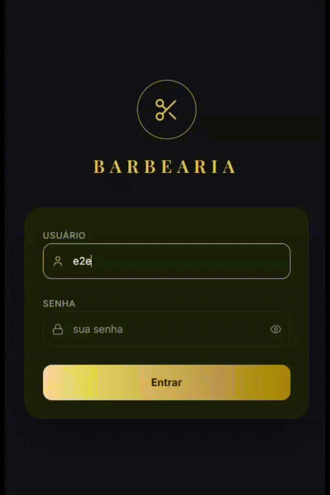
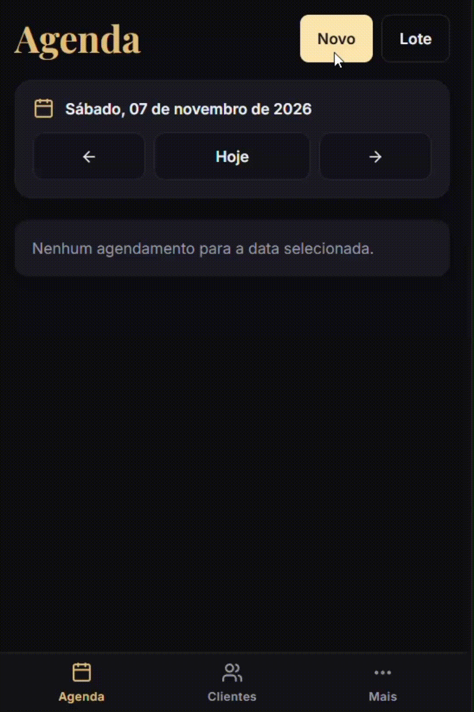

# Barbershop AI - Smart Scheduling System


[Português](README.md)

Barbershop scheduling system with AI-powered WhatsApp conversations. Monorepo with a business-rules backend and an administrative dashboard.

## What this project demonstrates

- A real barbershop uses the system in production.
- PostgreSQL handles concurrency with a `btree_gist` exclusion constraint, `FOR UPDATE` locking for package usage numbering, and transactional reactivation reservations per customer.
- Gemini is backed by deterministic guardrails: customer-name validation, internal-ID filtering, a full-block guard, and explicit confirmation before booking creation.
- CI runs the backend against ephemeral PostgreSQL 16.

### 1. Problem context

During appointments, the barber was losing time by manually answering scheduling messages on WhatsApp. This caused frequent interruptions, slower time-slot confirmations, and higher risk of booking conflicts.

### 2. Stack and infrastructure

#### Backend

- Node.js, TypeScript, Fastify, and Prisma.
- PostgreSQL (Neon).

#### Frontend

- React, Vite, TypeScript, and Tailwind CSS v4.
- Playwright for dashboard tests.

#### Integrations

- YCloud (WhatsApp Business Platform, production; coexistence).
- Evolution API (rollback).
- Google Gemini (Function Calling).
- Google Calendar API with a service account.

#### Infrastructure

- Railway: backend.
- Vercel: dashboard.
- Neon: PostgreSQL.

### 3. Core features

#### WhatsApp and AI

- Explicit booking confirmation: `prepararAgendamento` saves a draft; `confirmarAgendamento` creates the booking only after a new message confirms the summary. Drafts have a TTL and an automatic reminder.
- Human takeover with `BOT`, `ESCALADO`, and `HUMANO_ATIVO` states; echo processing depends on YCloud being the active provider.
- Escalation to human support for confusion, API usage limits, requests for human support, and requests outside the automated flow. Recurring-haircut requests (e.g., weekly for 1 or 2 months) are not booked as a series by the bot: it notifies the customer and forwards the request to the barber.
- Informational package lookup only for packages enabled with `liberadoParaGemini` (default `false`). Gemini never links packages or handles payment; interest in a fixed package and custom combinations is forwarded to the barber.
- Non-text media receives a notice. Audio transcription is optional and disabled by default (`AUDIO_TRANSCRIPTION_ENABLED`).
- When the requested date has no availability, Gemini offers upcoming dates with available times for the same service. If no availability remains within the horizon, it reports that limit.

#### Dashboard

- Client, service, and schedule operations with JWT authentication.
- Packages with multiple services, per-service balance, “N of M” numbering, and `usosAnteriores`; package sales during single and batch booking creation.
- Recurring batch scheduling.
- Time blocks and per-day business hours, including lunch breaks and closing extensions.
- Booking outside business hours is available only in the dashboard.
- Gemini scheduling horizon: 20-day default, configurable up to 180 days; optional `limiteAte` also restricts the window. Effective end is the earlier of today plus configured days and `limiteAte`, when set.
- Ignored phone-number list applied to YCloud and Evolution inbound messages, YCloud echoes used for takeover, and reactivation sends.
- Reports for appointments by service and period, inactive customers, and package balances. CSV export is generated in the dashboard; appointments API returns JSON. Estimated value uses the unit price saved with the appointment.
- Inactive-customer reactivation through YCloud template `notificar_inativo` (Marketing), with “Book now” and “Stop receiving messages” buttons. The first starts scheduling with Gemini; the second records customer opt-out. 30-day cooldown per customer and delivery status tracking through a webhook.

#### Operations and integrations

- One-way appointment mirror to Google Calendar (optional; `GOOGLE_CALENDAR_SYNC_ENABLED`, disabled by default). See [docs/google-agenda-backup.md](docs/google-agenda-backup.md).
- YCloud serves real customers through coexistence: the barber replies to customers in the WhatsApp Business app on his phone, using the barbershop number (`YCLOUD_FROM_NUMBER`).
- Rescheduling and cancellation notifications, plus human-support alerts.

### 4. Demo

**WhatsApp scheduling flow (AI)**


**Admin dashboard**



**Custom date/time picker**



### 5. Relevant architecture decisions

- Layered architecture: `routes` / `controllers` / `services` / `repositories`.
- Datetimes stored in UTC, with timezone conversion on input and output.
- Logical cancellation (`CANCELADO`) and PostgreSQL `btree_gist` exclusion constraint for concurrent booking conflicts.
- Anti-jailbreak filter in the WhatsApp webhook to block suspicious input.
- Separate outbound transport adapters for WhatsApp providers (Evolution/YCloud).
- Escalation state persisted in PostgreSQL.
- Message-ID idempotency with early ACK; deduplication applies only when an ID exists.
- `FOR UPDATE` lock for package usage numbering.
- When enabled, automatic package renewal locks in this order: appointment, customer, then balance; package-link creation locks the customer before the balance.
- Automatic WhatsApp package linking in Gemini locks the customer, then the service balance, then inserts the appointment; ineligible bookings remain unlinked.
- `precoUnitario` snapshot on each appointment preserves historical value used in reports.
- Reactivation uses a transactional reservation with `SELECT ... FOR UPDATE` on the customer row. Persisted opt-out is handled before takeover; `ENTREGUE` status never regresses after webhook reconciliation.
- Deterministic guardrails: customer-name validation, internal-ID filtering on outbound messages, and full-block guard. If the guard query fails, the system treats it as unavailable, not as a guaranteed block.
- Security: rate limiting, CORS allowlist, Helmet headers, and JWT in an httpOnly cookie; token revocation uses an in-memory `Set`; Evolution webhook uses `x-webhook-secret`, and YCloud webhook uses HMAC-SHA256.
- GitHub Actions CI runs Vitest against PostgreSQL 16.

### 6. Local setup

#### 6.1 Environment variables

Use `.env.example` as a starting point. Production must explicitly set `WHATSAPP_PROVIDER=ycloud`; required variables, defaults, and validation rules are documented in [docs/ENV.en.md](docs/ENV.en.md).

Essential variables: `DATABASE_URL`, `GEMINI_API_KEY`, `JWT_SECRET`, dashboard credentials, and YCloud settings (`YCLOUD_API_KEY`, `YCLOUD_WEBHOOK_SECRET`, `YCLOUD_FROM_NUMBER`, `BARBER_PHONE`).

`RENOVACAO_AUTOMATICA_ENABLED` controls package renewal (default `false`). When `true`, exhausting the balance creates a new cycle in the same transaction, copying services and quantities from the previous cycle, resetting `usosAnteriores` to zero, and leaving appointments unlinked. This records the cycle; it does not process payment.

`VINCULO_AUTOMATICO_WHATSAPP_ENABLED` accepts only `true` or `false` (default `false`). When enabled, Gemini confirmation attempts to link an active cycle if the service and a package number are available; otherwise, the appointment is created without a package. Preparing the summary does not decide or promise a package link.

The dashboard calls `GET /configuracao-agendamento` (JWT cookie authentication) to get `minAntecedenciaMinutos` and apply the local cutoff. The backend remains the source of truth.

When Gemini confirms a booking with lead time below `AVISO_CURTO_PRAZO_MINUTOS`, the barber receives YCloud template `aviso_agendamento_ultima_hora` (`pt_BR`, four parameters: customer, service(s), time, and minutes) at `BARBER_PHONE`. YCloud/Meta must approve the template before lowering `MIN_ANTECEDENCIA_MINUTOS` to 15.

#### 6.2 Backend (repository root)

```bash
npm install
npm run dev
```

Build and local run:

```bash
npm run build
npm start
```

#### 6.3 Frontend (`painel/`)

```bash
cd painel
npm install
npm run dev
```

Build the dashboard:

```bash
cd painel
npm run build
```

#### 6.4 YCloud (production provider)

Set `WHATSAPP_PROVIDER=ycloud` and configure YCloud credentials, `YCLOUD_FROM_NUMBER` in E.164 format, and `BARBER_PHONE`, a separate number that receives notices and escalations. `YCLOUD_FROM_NUMBER` is the barbershop number connected to YCloud and must differ from `BARBER_PHONE`. Coexistence, which lets the barber reply through the WhatsApp Business app using the barbershop number, is configured in the YCloud/Meta account, not in this repository.

Configure webhook as `https://<your-backend>/webhook/ycloud`. Subscribe to `whatsapp.inbound_message.received`, `whatsapp.smb.message.echoes`, and `whatsapp.message.updated`; the endpoint verifies an HMAC signature over the raw body.

`WHATSAPP_ALLOWLIST` is an optional validation tool and is not active in production. An absent or empty variable disables the filter.

In-window replies use text; proactive notifications use approved templates `aviso_reagendamento`, `aviso_cancelamento`, and `aviso_atendimento_humano`. Reactivation uses Marketing template `notificar_inativo`, with quick-reply buttons “Quero agendar” and “Não receber mais”.

#### 6.5 Evolution (rollback)

The code assumes `evolution` when `WHATSAPP_PROVIDER` is unset. Production explicitly sets `ycloud`. To roll back, set `WHATSAPP_PROVIDER=evolution`, restore Evolution configuration, redeploy, and verify `/webhook/whatsapp` and Evolution outbound sending before disabling the YCloud endpoint. Evolution webhook: `https://<your-backend>/webhook/whatsapp`.

### 7. Tests

- Backend: more than 1,000 cases (`npm run test`): 914 unit and 88 integration cases.
- `npm run test:unit` runs unit tests without integrations. `npm run test:integration` runs all 13 integration files without file parallelism: twelve require PostgreSQL; `auth.cookie.integration.test.ts` runs in memory. They need an explicit `DATABASE_URL` because dotenv is not loaded under `VITEST`.
- Dashboard unit tests: Playwright via `cd painel && npm run test:unit`.
- E2E: `cd painel && npx playwright test`; requires `E2E_USER`, `E2E_PASSWORD`, the development backend, and the dashboard running.
- CI runs the complete backend suite, including integrations, against ephemeral PostgreSQL 16 after `prisma migrate deploy`. CI does not run dashboard tests.

### 8. Project status

The system is in production and serves the barbershop's customers. The dashboard is in active use; WhatsApp automation runs through YCloud coexistence. Evolution remains available only as a rollback option.

### 9. Deployment

When a migration is needed, deploy the backend before the dashboard. On Railway, `prisma migrate deploy && npm start` is configured on the platform (not versioned in the repository). The dashboard is deployed on Vercel; the `/api` rewrite is defined in [painel/vercel.json](painel/vercel.json).

### 10. Author

- Name: Víctor Barsanele
- LinkedIn: https://linkedin.com/in/victorbarsanele
- GitHub: https://github.com/victorbarsanele
