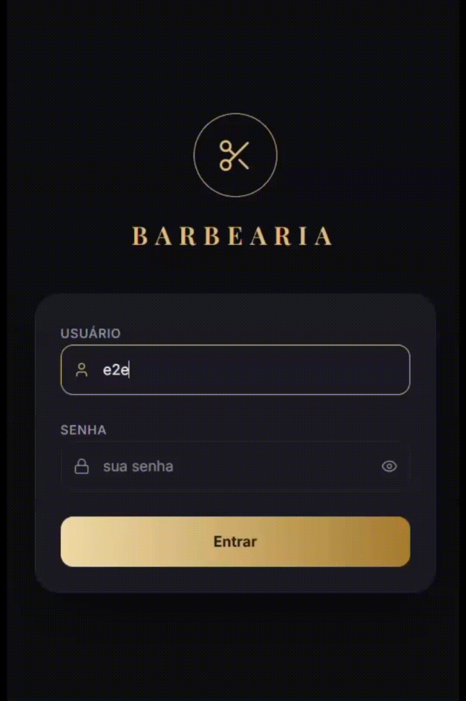
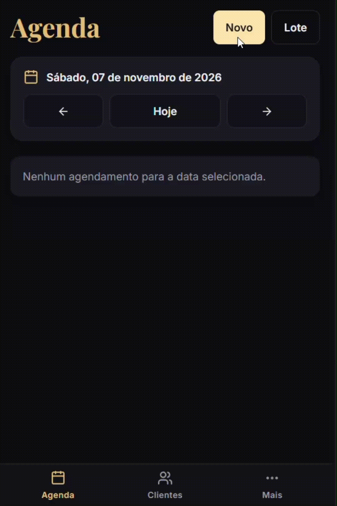

# Barbearia IA - Sistema de Agendamento Inteligente


[English](README.en.md)

Sistema de agendamento para barbearia com automação de conversas via WhatsApp e IA. Monorepo com backend de regras de negócio e painel administrativo.

## O que este projeto demonstra

- Sistema usado por uma barbearia real em produção.
- Concorrência tratada no PostgreSQL com exclusion constraint `btree_gist`, lock `FOR UPDATE` na numeração de pacote e reserva transacional de reativação por cliente.
- Gemini complementado por guardrails determinísticos: validação de nome, filtro de IDs internos, guarda de bloqueio total e confirmação explícita antes de gravar.
- CI executa backend contra PostgreSQL 16 efêmero.

### 1. Contexto do problema

Durante atendimentos, o barbeiro perdia tempo respondendo manualmente mensagens de agendamento no WhatsApp. Isso gerava interrupções frequentes, atraso na confirmação de horários e risco maior de conflito entre reservas.

### 2. Stack e infraestrutura

#### Backend

- Node.js, TypeScript, Fastify e Prisma.
- PostgreSQL (Neon).

#### Frontend

- React, Vite, TypeScript e Tailwind CSS v4.
- Playwright para testes do painel.

#### Integrações

- YCloud (WhatsApp Business Platform, produção; coexistência).
- Evolution API (rollback).
- Google Gemini (Function Calling).
- Google Calendar API com service account.

#### Infraestrutura

- Railway: backend.
- Vercel: painel.
- Neon: PostgreSQL.

### 3. Funcionalidades principais

#### WhatsApp e IA

- Agendamento com confirmação explícita: `prepararAgendamento` salva rascunho; `confirmarAgendamento` grava após nova mensagem confirmando o resumo. Rascunhos têm TTL e lembrete automático.
- Takeover humano com estados `BOT`, `ESCALADO` e `HUMANO_ATIVO`; registro de eco depende do provedor YCloud.
- Escalonamento para atendimento humano em caso de confusão, limite de uso da API, pedido de atendimento humano e solicitações fora do fluxo automatizado. Pedidos de cortes recorrentes (ex.: semanais por 1 ou 2 meses) não são agendados em série pelo bot: ele avisa o cliente e encaminha o pedido ao barbeiro.
- Consulta informativa de pacotes apenas quando liberados com `liberadoParaGemini` (padrão `false`). Gemini não vincula pacote nem trata pagamento; interesse em pacote fixo e combinações personalizadas seguem para o barbeiro.
- Mensagens de mídia não textual recebem aviso. Transcrição de áudio é opcional e desligada por padrão (`AUDIO_TRANSCRIPTION_ENABLED`).
- Quando não há vaga na data pedida, Gemini oferece próximas datas com horários disponíveis para o mesmo serviço. Se não houver disponibilidade até o horizonte, informa esse limite.

#### Painel

- Operação de clientes, serviços, agenda e autenticação JWT.
- Pacotes com múltiplos serviços, saldo por serviço, numeração “N de M” e `usosAnteriores`; venda de pacote na criação avulsa e em lote.
- Agendamento recorrente em lote.
- Bloqueios de horário e expediente configurável por dia, incluindo almoço e extensão de fechamento.
- Encaixe fora do expediente disponível somente no painel.
- Horizonte de agenda do Gemini: padrão de 20 dias, configurável até 180; `limiteAte` opcional também restringe a janela. O fim efetivo é o menor entre hoje + dias configurados e `limiteAte`, quando definida.
- Lista de números ignorados aplicada a mensagens recebidas por YCloud e Evolution, ecos YCloud usados no takeover e envios de reativação.
- Relatórios de atendimentos por serviço e período, clientes inativos e saldo de pacotes. Exportação CSV é gerada no painel; API de atendimentos retorna JSON. Valor estimado usa preço unitário salvo no agendamento.
- Reativação de clientes inativos por template YCloud `notificar_inativo` (Marketing), com botões “Quero agendar” e “Não receber mais”. O primeiro inicia o agendamento com Gemini; o segundo registra opt-out no cliente. Cooldown de 30 dias por cliente e acompanhamento de entrega por webhook.

#### Operação e integrações

- Espelho unidirecional de agendamentos para Google Agenda (opcional; `GOOGLE_CALENDAR_SYNC_ENABLED`, desligado por padrão). Consulte [docs/google-agenda-backup.md](docs/google-agenda-backup.md).
- YCloud atende clientes reais em coexistência: barbeiro responde aos clientes pelo app WhatsApp Business no celular, usando o número da barbearia (`YCLOUD_FROM_NUMBER`).
- Notificações de reagendamento e cancelamento, além de alertas de atendimento humano.

### 4. Demonstração

**Agendamento via WhatsApp (IA)**


**Painel administrativo**



**Seleção de data e horário**



### 5. Decisões de arquitetura relevantes

- Organização em camadas: `routes` / `controllers` / `services` / `repositories`.
- Datas armazenadas em UTC, com conversão de timezone na entrada e saída.
- Cancelamento lógico (`CANCELADO`) e exclusion constraint PostgreSQL `btree_gist` para conflitos concorrentes.
- Filtro anti-jailbreak no webhook do WhatsApp para bloquear entradas suspeitas.
- Adapter de saída separado por provedor WhatsApp (Evolution/YCloud).
- Estado de escalonamento persistido em PostgreSQL.
- Idempotência por ID de mensagem com ACK antecipado; deduplicação só ocorre quando ID existe.
- Lock `FOR UPDATE` na numeração de pacote.
- Snapshot de `precoUnitario` no agendamento preserva valor histórico usado nos relatórios.
- Reativação usa reserva transacional com `SELECT ... FOR UPDATE` na linha do cliente. Opt-out persistido é tratado antes do takeover; status `ENTREGUE` não regride após reconciliação por webhook.
- Guardrails determinísticos: validação de nome, filtro de IDs internos na saída e guarda de bloqueio total. Se consulta da guarda falhar, sistema trata como indisponibilidade, não como bloqueio garantido.
- Segurança: rate limiting, CORS allowlist, cabeçalhos Helmet e JWT em cookie httpOnly; revogação de tokens em `Set` em memória; segredo `x-webhook-secret` no webhook Evolution e HMAC-SHA256 no webhook YCloud.
- CI via GitHub Actions executa Vitest contra PostgreSQL 16.

### 6. Como rodar localmente

#### 6.1 Variáveis de ambiente

Use `.env.example` como base. Produção deve definir `WHATSAPP_PROVIDER=ycloud` explicitamente; detalhes de obrigatoriedade, defaults e validação estão em [docs/ENV.md](docs/ENV.md).

Variáveis essenciais: `DATABASE_URL`, `GEMINI_API_KEY`, `JWT_SECRET`, credenciais de painel e configurações YCloud (`YCLOUD_API_KEY`, `YCLOUD_WEBHOOK_SECRET`, `YCLOUD_FROM_NUMBER`, `BARBER_PHONE`).

O painel consulta `GET /configuracao-agendamento` (autenticado por cookie JWT) para obter `minAntecedenciaMinutos` e aplicar o corte local. Backend continua como fonte da verdade.

Quando Gemini confirma agendamento com antecedência menor que `AVISO_CURTO_PRAZO_MINUTOS`, barbeiro recebe template YCloud `aviso_agendamento_ultima_hora` (`pt_BR`, quatro parâmetros: cliente, serviço(s), horário e minutos), enviado a `BARBER_PHONE`. Template precisa de aprovação da YCloud/Meta antes de reduzir `MIN_ANTECEDENCIA_MINUTOS` para 15.

#### 6.2 Backend (raiz)

```bash
npm install
npm run dev
```

Build e execução local:

```bash
npm run build
npm start
```

#### 6.3 Frontend (`painel/`)

```bash
cd painel
npm install
npm run dev
```

Build do painel:

```bash
cd painel
npm run build
```

#### 6.4 YCloud (provedor de produção)

Defina `WHATSAPP_PROVIDER=ycloud` e configure credenciais YCloud, `YCLOUD_FROM_NUMBER` em formato E.164 e `BARBER_PHONE`, número distinto que recebe avisos e escalonamentos. `YCLOUD_FROM_NUMBER` é o número da barbearia conectado à YCloud e deve ser diferente de `BARBER_PHONE`. A coexistência, que permite ao barbeiro responder pelo app WhatsApp Business usando o número da barbearia, é configurada na conta YCloud/Meta, não no repositório.

Configure webhook como `https://<seu-backend>/webhook/ycloud`. Inscreva `whatsapp.inbound_message.received`, `whatsapp.smb.message.echoes` e `whatsapp.message.updated`; endpoint valida assinatura HMAC do corpo bruto.

`WHATSAPP_ALLOWLIST` é recurso opcional para validação, não está ativa em produção. Lista vazia ou variável ausente desativa filtro.

Respostas dentro da janela usam texto; notificações proativas usam templates aprovados `aviso_reagendamento`, `aviso_cancelamento` e `aviso_atendimento_humano`. Reativação usa o template de Marketing `notificar_inativo`, com botões de resposta rápida “Quero agendar” e “Não receber mais”.

#### 6.5 Evolution (rollback)

Código assume `evolution` quando `WHATSAPP_PROVIDER` não está definida. Produção define `ycloud` explicitamente. Para rollback, configure `WHATSAPP_PROVIDER=evolution`, restaure configuração Evolution, faça redeploy e confirme `/webhook/whatsapp` e envio Evolution antes de desativar endpoint YCloud. Webhook Evolution: `https://<seu-backend>/webhook/whatsapp`.

### 7. Testes

- Backend: mais de 1.000 casos (`npm run test`): 914 unitários e 88 de integração.
- `npm run test:unit` executa testes unitários, sem integrações. `npm run test:integration` executa os 13 arquivos de integração sem paralelismo entre arquivos: doze exigem PostgreSQL; `auth.cookie.integration.test.ts` roda em memória. Os testes usam `DATABASE_URL` explícita porque dotenv não é carregado sob `VITEST`.
- Painel: unitários via Playwright com `cd painel && npm run test:unit`.
- E2E via `cd painel && npx playwright test`; exige `E2E_USER`, `E2E_PASSWORD`, backend de desenvolvimento e painel rodando.
- CI executa backend completo, incluindo integrações, contra PostgreSQL 16 efêmero após `prisma migrate deploy`. CI não executa testes do painel.

### 8. Status do projeto

Sistema em produção, atendendo clientes da barbearia. Painel está em uso ativo; automação WhatsApp opera via YCloud em coexistência. Evolution permanece disponível somente como rollback.

### 9. Deploy

Quando houver migration, publique backend antes do painel. Na Railway, `prisma migrate deploy && npm start` está configurado na plataforma (não versionado no repo). Painel é publicado na Vercel; rewrite de `/api` está definido em [painel/vercel.json](painel/vercel.json).

### 10. Autor

- Nome: Víctor Barsanele
- LinkedIn: https://linkedin.com/in/victorbarsanele
- GitHub: https://github.com/victorbarsanele
